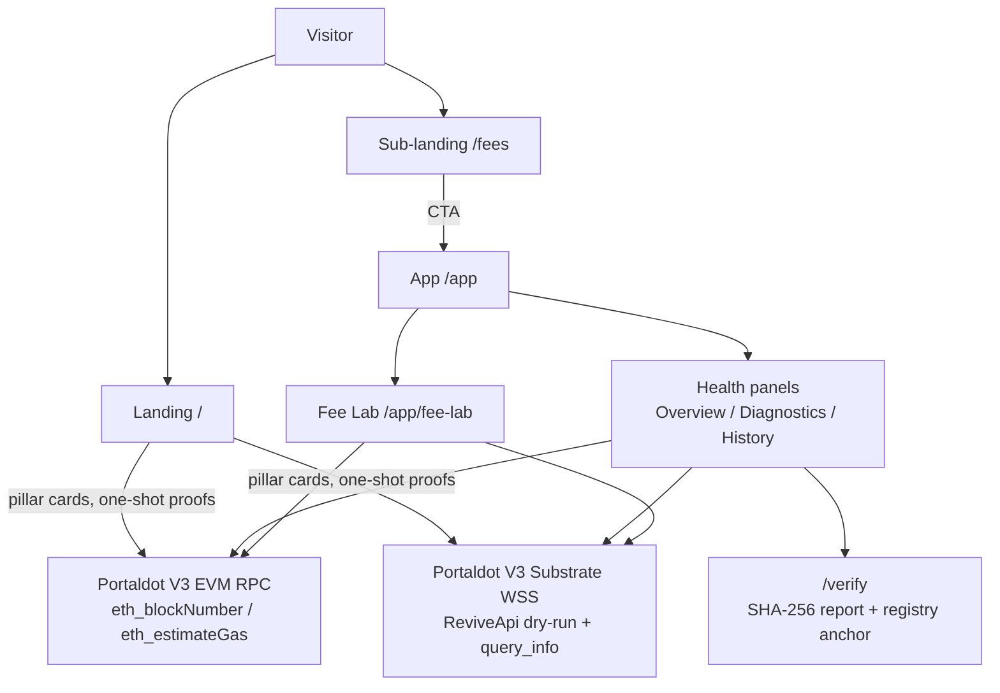

# NodeScope


[](https://github.com/Firzadf/nodescope/actions/workflows/ci.yml)

NodeScope is a node truth suite for Portaldot V3: two pillars, one evidence
discipline. **Health** proves a node stayed healthy over time through
timestamped snapshots, deterministic before/after comparison, and
SHA-256-verifiable reports. **Fees** prices one operation on the EVM
surface and the native surface side by side, so the real cost is visible
instead of the headline multiple.

## Evidence, in short

- Registry (ownerless, Portaldot V3 testnet, chain 420420777):
  `0xd48da7eff3264bdd51a86b873da9ff6997aae99c`
- Deploy tx `0x1c2a055523a4cf8b73d771df4d3c54d21392a85f86a14a4d68213bf6db5f4904`
  (block 216268). Three anchors: Health #1 (block 216341), Fees (block
  216343), Health #2 (block 216346, latest anchor tx
  `0xc74a08f3835b0c5b7d813ab15597488affa1987bce79a88d843dfdc31a9ec913`,
  report hash
  `0x528f38d58920b2c7fef730c27e95200e429a126874746e8cead5c1146c768a5b`).
  Check any anchor at https://nodescope.vercel.app/verify.
- Fees finding, measured 27 Oct 2026: a contract deploy costs 124.098 tPOT
  on EVM vs 122.191 tPOT native all-in — 1.016x all-in, not the 804x
  fee-only headline. Most of the gap is a refundable storage deposit.
- 470 passing tests across 68 test files. CI green on Ubuntu and Windows
  (Foundry on Ubuntu), plus a `verify:evidence` job that rechecks every
  anchor on chain.

## Reproduce the evidence

Judges and operators do not need to trust any number in this README. `docs/REPRODUCE.md` gives the exact curl commands for the live testnet, the 60-second path through the app, and the report verification steps at /verify, plus what NodeScope deliberately does not do.

## Demo Materials

- **Demo video:** [Watch on YouTube](https://youtu.be/TyTudF3MUaI)
- **Live app:** [nodescope.vercel.app](https://nodescope.vercel.app/)
- **DoraHacks BUIDL:** [NodeScope project](https://dorahacks.io/build/50146/)
- **Screenshots:** [Representative screenshots](docs/screenshots/README.md)


## Project Overview

NodeScope is built for the Portaldot Hacker House 2026 (Track 3: Node Operations & Tooling). The application provides:

- **User-triggered health checks** — explicit snapshot runs against configurable endpoints and profiles
- **Timestamped snapshots** — captures check outcomes, block heights, latency, and derived diagnostic findings
- **Before/after comparison** — visual diff of two snapshots showing new/resolved findings, block height delta, latency trends
- **Diagnostic report export** — standards-compliant JSON export with full raw history and deduplicated findings
- **Portaldot V3.0 EVM integration** — verified against chain ID 420420777, methods tested, Substrate method limits documented (-32601 for unsupported methods)
- **Professional dashboard UI** — dark navy theme, cyan/teal accents, responsive layout
- **RPC diagnostic workspace** — raw JSON-RPC method testing for ad-hoc exploration

## Technology Stack

- **React 19** with TypeScript
- **Vite 8** for fast development and building
- **Tailwind CSS 4** for styling
- **Lucide React** for icons
- **Vitest 5** and **@testing-library/react** for testing
- **Node.js & npm** for dependency management

## Requirements

- Node.js 18+ (LTS or later)
- npm 9+
- Windows, macOS, or Linux
- Modern browser with ES2020 support

## Quick Start

### Installation

Clone or navigate to the project directory:

```bash
cd nodescope
```

Install dependencies:

```bash
npm install
```

### Development

Start the local development server with hot module reloading:

```bash
npm run dev
```

The application will be available at `http://localhost:5173`.

### Testing

Run the complete test suite:

```bash
npm test
```

Run tests once (non-watch mode):

```bash
npm test -- --run
```

Run tests with coverage:

```bash
npm run test:coverage
```

### Linting & Type Checking

Lint code:

```bash
npm run lint
```

Build (type check + bundle):

```bash
npm run build
```

Preview production build:

```bash
npm run preview
```

## Implemented Features

### Phase 1 — Health Check Snapshots (Complete ✅)

- **Run Health Check button** — triggers user-initiated check suite against configured endpoint
- **Profile-aware check methods** — Portaldot V3 EVM profile: `eth_chainId`, `eth_blockNumber`, `web3_clientVersion`, `net_version`; generic HTTP profile: `system_health`, `system_version`, `chain_getHeader`, `eth_chainId`
- **Check result classification** — outcome types: success, unsupported_method (-32601), rpc_error, network_error, http_error, invalid_response
- **Captured metrics** — method, outcome, success flag, latency (ms), observed value (string or number), error message
- **Derived findings** — automatic classification via diagnostic rules: chain ID validation, method support, latency threshold, HTTP/network errors
- **Timestamped snapshot storage** — sessionStorage-backed, max 20 snapshots per session, includes snapshot ID, timestamp, endpoint origin, profile, checks, and deduplicated findings
- **Latest snapshot display** — Health Check Panel shows individual check results and derived findings with severity badges

**Test Coverage (Phase 1):** included in the 197-test suite below.

### Phase 2 — Snapshot Comparison (Complete ✅)

- **Snapshot A/B selector** — user-selectable baseline (older) and current (newer) snapshots
- **Default selection** — if 2+ snapshots exist, automatically selects the two most recent (newest-first ordering, chosen by timestamp)
- **Empty state** — explicit message when <2 snapshots; comparison disabled
- **Compatibility check** — same endpoint/profile marked "like-for-like"; cross-endpoint marked with warning
- **Block height delta** — safely derived only when both snapshots contain valid eth_blockNumber or equivalent; displayed as decimal string with status (success, unavailable, unsupported, invalid)
- **Check differences table** — method, status (unchanged/changed/added/removed), outcome change, observed value (A → B), latency delta
- **Finding differences categorization** — new_finding, resolved_finding, unchanged_finding, each showing ruleId, severity, title, evidence
- **Null handling** — explicitly distinguishes unavailable from 0, false, or ""
- **Pure comparison** — deterministic output, no mutation of stored snapshots

### Fixes After Phase 2

- **First-load Connect button** — endpoint state now initializes from the shared `DEFAULT_PORTALDOT_V3_EVM_RPC` constant, so a prefilled valid URL enables "Connect & Test" immediately without typing
- **Snapshot recency** — latest snapshot is selected by maximum `timestamp` rather than array position, matching the newest-first storage order from `saveHealthSnapshot`
- **Latency-only changes** — a check whose only difference is latency no longer flips status to `changed`; status tracks outcome, success, observedValue, and error
- **Demo banner** — overview banner renders only while `connectionStatus !== 'connected'`
- **Duplicate error text** — removed the doubled "Fail — …" string in the EVM connection detail card

### Core Infrastructure (Complete ✅)

- **JSON-RPC client** (`rpcClient.ts`) — generic HTTP POST client with timeout, latency measurement, error classification
- **Endpoint profiles** — `portaldot_v3_evm` (EVM methods), `generic_http` (Substrate methods) with profile-specific defaults
- **Endpoint configuration UI** — URL input, profile selector, CORS behavior documentation
- **RPC Console** — method presets with evidence labels (live_verified, unverified, returns_-32601_on_evm_endpoint), raw response inspection
- **Capability discovery** — advertised vs. tested methods per endpoint, distinguished from actual failures
- **Diagnostic rules** — evaluateHistoryFindings, deduplicateFindings, evaluateDiagnosticResult, endpoint-aware dedup by ruleId + endpoint
- **Diagnostic findings** — schema with ruleId, severity (info/warning/error), title, evidence, explanation, recommendation
- **Report export** — schema `nodescope.diagnostic-report.v1`, includes raw history (recordCount), sanitized endpoint origin, optional deduplicated findings
- **URL validation** — http:// and https:// only, credential stripping, query parameter redaction
- **Chain ID validator** — Portaldot V3.0 chain ID 420420777 (0x190f1ca9) with comparison and error messages

### Fee Lab — EVM vs Native Fee Comparison (Complete ✅)

The Fee Lab module lives in the app sidebar as **Fee Lab** (`/app/fee-lab`), with its own sub-landing at `/fees`.

- **Same operation, both surfaces** — native transfer, ERC-20 transfer, contract deploy (sample, registry, or your own artifact: pasted creation bytecode, constructor args, or an uploaded solc artifact JSON, plus a share link that reopens Fee Lab with the contract preloaded), and pasted calldata. The From address is only a dry-run origin; nothing signs.
- **EVM leg** — `eth_estimateGas` × `eth_gasPrice`. The gas figure already folds the storage deposit in.
- **Native leg** — `ReviveApi` dry-run plus `TransactionPaymentApi.query_info` over the Substrate WebSocket (via `@polkadot/api`, lazy-loaded on first measure), reported as partialFee + storage deposit separately.
- **Honest comparison** — all-in ratio (EVM ÷ native fee + deposit) next to the fee-only ratio (EVM ÷ native fee), which is how "~800×" headlines are usually produced. Within 2% all-in, the recommendation reads "either".
- **Doctrine kept** — user-triggered only: no connection opens until you measure, nothing polls, and the Substrate connection closes when you leave the section. No placeholder numbers; a surface that fails reports `unavailable` with its reason instead of a dressed-up value.
- **Deferred to phase 2** — Calculator, Address converter, History recording, Leaderboard, on-chain Verify, and optional wallet Deploy pages. They were not built in phase 1 to keep the release clean.

### Fees methodology

How a Fee Lab number is produced, and what it does and does not claim:

- **EVM leg** — `eth_estimateGas` × `eth_gasPrice` for the same operation, converted to tPOT at 18 decimals. On pallet-revive the EVM gas figure already folds the storage deposit in.
- **Native leg** — `ReviveApi` dry-run plus `TransactionPaymentApi.query_info` over the Substrate WebSocket, reported as two separate numbers: `partialFee` (weight fee) and `storageDeposit` (reserved hold, refundable when the storage it paid for is freed). All-in native cost = partialFee + storage deposit, at 14 decimals.
- **Two ratios, always shown together** — all-in (EVM ÷ native fee + deposit, the like-with-like comparison) next to fee-only (EVM ÷ native partialFee, the denominator most "~800×" headlines use). Within 2% all-in, the recommendation reads "either".
- **One measured run, dated** — 26 Oct 2026 (~13:13 UTC), runtime `portaldot-v3` spec 3002: deploy of the 1,414-byte SampleToken measured EVM 124.098219 tPOT against native all-in 122.191411 tPOT (fee 0.154411 + deposit 122.037), i.e. 804x fee-only versus 1.016x all-in. Plain transfers in the same run measured EVM 7-12% cheaper all-in (0.880x and 0.933x), because they add no new storage and therefore carry no deposit.
- **Timeouts, no polling** — native connect 10s with no auto-reconnect, native estimate 15s, EVM request 10s with one retry on network failure. Nothing opens until the visitor presses Measure; a failed leg reports `unavailable` with its reason.
- **Honest limits** — the claim "EVM gas folds the deposit in" is an inference from the numbers (EVM total matching native fee + deposit within ~1.6%), not a statement read in pallet-revive documentation. Gas prices move, so a ratio measured today is a measurement, not a permanent property of the chain. Re-measure live in Fee Lab before quoting a number.

## For builders: CLI, GitHub Action, and custom artifacts

NodeScope is not only a website. The same measurements run headless, so
other Portaldot builders can gate a deploy on them:

- **CLI — `npx nodescope`** (from a repo checkout; the package stays
  private and nothing is published to npm). `nodescope check <rpc>`
  prints a healthy / degraded / down verdict for an EVM endpoint.
  `nodescope fees --artifact <solc artifact JSON>` prices the same
  deploy on EVM (eth_estimateGas × eth_gasPrice) and native (ReviveApi
  dry-run + paymentInfo), with `--max-tpot` failing the run when the
  cheapest priced all-in cost exceeds the budget. Exit codes and the
  full flag list are documented in `cli/README.md`; nothing signs,
  nothing needs a key.
- **GitHub Action — `action.yml`** wraps the CLI for CI: check the node,
  price the deploy, fail the job when the node is unhealthy, the EVM leg
  is unpriceable, or the cost exceeds `max-tpot`. Example:

```yaml
- uses: Firzadf/nodescope@v1
  with:
    rpc: https://test-evm-rpc-v3.portaldot.dev
    artifact: out/MyContract.sol/MyContract.json
    max-tpot: '200'
```

- **Custom artifacts in Fee Lab** — paste creation bytecode, add
  ABI-encoded constructor args, or upload a solc artifact JSON (creation
  bytecode only; deployedBytecode-only artifacts are rejected plainly).
  A share link (`/app/fee-lab?op=deploy&code=…&args=…&from=…`) reopens Fee
  Lab with the contract preloaded, and the export still emits the
  stamped v1 report.

## Business model

Free, open source (MIT): the app, the Fee Lab, the CLI, the GitHub
Action, and the attestation registry. Paid, when there is demand to
charge for:

- **Hosted monitoring + alerts for node operators** — the Health checks
  run on NodeScope infrastructure on a schedule, with alerts when a node
  degrades, instead of the operator running the checks themselves.
- **Pre-deploy cost gate for teams / CI** — the Action above as a
  managed gate with history: every deploy priced, every price recorded,
  budgets enforced across a team.

Targets: Portaldot builders, node operators, and wallets / dApps that
need EVM vs native routing. Market sizing, only from verified numbers:
the Week 2 check-in reviewed 62 projects and passed 54 (check-in
results, 27 Oct 2026); the tool speaks to builders on two public
testnet endpoints (one EVM RPC, one Substrate WebSocket). No total
addressable market is claimed: builder counts beyond the check-in
document are unverified and are not used here.

## Adoption

No team has tried Fee Lab or the CLI on their own contract yet. The
outreach message and the results table live in
`docs/ADOPTION-OUTREACH.md`, and the table stays empty until a team
actually replies. Quotes and results are added only when real, never
invented.

| Team | Contract priced | EVM | Native all-in | Their words |
| --- | --- | --- | --- | --- |
| _Waiting for the first teams._ | | | | |

## Portaldot Integration & Deployment Evidence

### Verified Endpoint

- **URL:** `https://test-evm-rpc-v3.portaldot.dev`
- **Transport:** HTTP JSON-RPC POST via browser fetch()
- **CORS:** cross-origin requests permitted; direct browser fetch() verified working
- **Connection Verified:** Oct 21, 2026, 22:10–22:11 WIB via direct client testing

### Chain ID Verification

- **Chain ID:** `420420777` (0x190f1ca9)
- **Method:** `eth_chainId`
- **Status:** ✅ live_verified
- **Date:** Oct 21, 2026

### Observed Block Heights

| Timestamp | Method | Block Height (Decimal) | Block Height (Hex) | Status |
|-----------|--------|----------------------|------------------|--------|
| 2026-10-21 22:10:55 WIB | eth_blockNumber | 133242 | 0x2087a | ✅ success |
| 2026-10-21 22:11:38 WIB | eth_blockNumber | 133248 | 0x20880 | ✅ success |
| 2026-10-22 15:48:05 WIB | eth_blockNumber | 143764 | 0x23194 | ✅ success |
| 2026-10-22 15:49:21 WIB | eth_blockNumber | 143776 | 0x231a0 | ✅ success |

Block height advanced from 133248 (Oct 21, 22:11 WIB) to 143776 (Oct 22, 15:49 WIB) — 10,528 blocks across ~17.6 hours, consistent with continuous testnet production.

### Verified RPC Methods (EVM Endpoint)

| Method | Status | Evidence | Notes |
|--------|--------|----------|-------|
| `eth_chainId` | ✅ live_verified | Returns 0x190f1ca9 (420420777) | Chain identity confirmed |
| `eth_blockNumber` | ✅ live_verified | Returns current block hex (e.g., 0x231a0 = 143776) | Block production confirmed |
| `web3_clientVersion` | ✅ live_verified | Returns client string (e.g., eth-rpc/main-fddd431) | Used in health checks |
| `net_version` | ✅ live_verified | Standard EVM method, included in health checks | Network identifier |
| `system_health` | ⚠️ returns_-32601 | JSON-RPC error [-32601] on EVM endpoint | Substrate-only method; expected on EVM profile |
| `system_version` | ⚠️ returns_-32601 | JSON-RPC error [-32601] on EVM endpoint | Substrate-only method; expected on EVM profile |
| `chain_getHeader` | ⚠️ returns_-32601 | JSON-RPC error [-32601] on EVM endpoint | Substrate-only method; expected on EVM profile |

### Application Behavior on EVM Profile

When endpoint profile is set to `portaldot_v3_evm`:

1. Health check runs: `eth_chainId`, `eth_blockNumber`, `web3_clientVersion`, `net_version`
2. Chain ID validated against 420420777; findings generated on mismatch or RPC error
3. Substrate methods (`system_health`, `system_version`, `chain_getHeader`) are **not called** on EVM profile
4. If a user manually enters a Substrate method in RPC Console and runs it against EVM endpoint, the -32601 error is captured and labeled `unsupported_method` in the UI

### Honest Limitations

- **HTTP JSON-RPC plus one WebSocket probe** — the EVM checks run over HTTP, and a separate user-triggered probe covers the Substrate WebSocket endpoint `wss://test-node-v3.portaldot.dev` (system_health, system_chain, system_version, chain_getHeader). No polling and no background WebSocket connection
- **Browser CORS dependency** — cross-origin requests must be permitted by the RPC endpoint for direct browser fetch() to work. A private or firewalled endpoint may require a local proxy (not provided)
- **SessionStorage-only snapshots** — stored in browser sessionStorage, limited to ~5MB per domain, max 20 snapshots cached per session. Snapshots lost on tab close or browser restart; export them to JSON for long-term retention
- **App never signs, one registry deployed** — NodeScope is a diagnostic and monitoring tool, not a contract IDE or wallet. The app never signs anything; the single ownerless attestation registry above exists only so a report hash can be anchored with the user's own wallet tool and verified read-only afterwards
- **No private key handling** — no seed phrases, private keys, or wallet mnemonics accepted; the tool only reads node state via RPC

### On-chain attestation (optional, read-only in the app)

A report's SHA-256 hash can be anchored on the Portaldot V3 testnet with the user's own wallet tool (the app never signs). The app and `/verify` then check the anchor by reading the transaction receipt through the RPC — there is no public EVM explorer for this chain.

- Registry contract (ownerless): `0xd48da7eff3264bdd51a86b873da9ff6997aae99c` (chain 420420777, deployed 27 Oct 2026, deploy tx `0x1c2a055523a4cf8b73d771df4d3c54d21392a85f86a14a4d68213bf6db5f4904`, block 216268 / 0x34ccc)
- Anchor transaction (latest): `0xc74a08f3835b0c5b7d813ab15597488affa1987bce79a88d843dfdc31a9ec913` (block 216346 / 0x34d1a)
- Anchored report hash (latest): `0x528f38d58920b2c7fef730c27e95200e429a126874746e8cead5c1146c768a5b` (exported 2026-10-27T10:20:20Z, 12 records, diagnostic with session trends)
- All three anchors on this registry: diagnostic report 1 (`0x08ac72ad0f7a818bc18a8624232811fc4f994cf065bbd2cad1eea4b0bb002df4`, tx `0xba35df8e2f182d75885b75b75f0dd97340f4ce64333840d1cf06a252441e9476`, block 216341), Fee Lab fee report (`0x246d6d43b308b8801109910bb52d8ad8d264376e7c8557255b3704176ada0464`, tx `0x0c08335507cfb2a0df4b0236543607aed04527ec26361e6e0022c9100c88f2c9`, block 216343), diagnostic report 2 (`0x528f38d58920b2c7fef730c27e95200e429a126874746e8cead5c1146c768a5b`, tx `0xc74a08f3835b0c5b7d813ab15597488affa1987bce79a88d843dfdc31a9ec913`, block 216346)
- Earlier anchor (25 Oct 2026, supplement, previous registry): registry `0x74c88d3090aD6915BFDc373eD6F037e2da4557Ce`, anchor tx `0xa7cd3cbd060335d851494c1f48e15124ec8d32ccfa3fe03413c85cf895625448` (block 179228), report hash `0x0bc787de4c634a55699e92d90b7280fffebdbcd557c4312044134e4df9dfa286` (exported 2026-10-24T20:12:08Z, 14 records)
- Contract source: `contracts/NodeScopeAttestation.sol` · Deployment record: `deployments/portaldot-v3.json` · Full write-ups: `docs/EVIDENCE.md`, `docs/DEPLOYMENT.md`, `docs/ATTESTATION.md`
- Verify the latest anchor: https://nodescope.vercel.app/verify?hash=0x528f38d58920b2c7fef730c27e95200e429a126874746e8cead5c1146c768a5b&contract=0xd48da7eff3264bdd51a86b873da9ff6997aae99c&tx=0xc74a08f3835b0c5b7d813ab15597488affa1987bce79a88d843dfdc31a9ec913
- Verify the earlier anchor: https://nodescope.vercel.app/verify?hash=0x0bc787de4c634a55699e92d90b7280fffebdbcd557c4312044134e4df9dfa286&contract=0x74c88d3090aD6915BFDc373eD6F037e2da4557Ce&tx=0xa7cd3cbd060335d851494c1f48e15124ec8d32ccfa3fe03413c85cf895625448

## Architecture

NodeScope is one build with two pillars, one brand, and one honesty doctrine (live numbers, no polling, no keys held, no score):

- **NodeScope Health** — is the node honest about its condition? Diagnostics, snapshots, trends, and the combined EVM + Substrate verdict, with on-chain attestation of exported reports. Lives in the app sidebar group **Health** (Overview, RPC Diagnostics, History) and on the landing page.
- **NodeScope Fees** — are its fees honest? The same operation priced on EVM and native, fee-only versus all-in, with the storage deposit shown separately. Lives in the app sidebar group **Fees** (Fee Lab, `/app/fee-lab`) and on the sub-landing `/fees`.



See [docs/architecture.md](docs/architecture.md) for component and data-flow diagrams.

### Project Structure

```
src/
├── components/
│   ├── common/                   # Reusable: Card, Badge
│   ├── dashboard/                # Overview, HealthCheckPanel, SnapshotComparison
│   ├── diagnostics/              # RpcConsole, DiagnosticReport, CapabilityDiscoveryPanel
│   ├── layout/                   # Header, Sidebar, ConnectionStatus
│   └── metrics/                  # NodeMetricsInspector
├── config/                        # Chain presets, RPC endpoint defaults
├── hooks/                         # Future: useRpcPolling, useLocalStorage
├── services/
│   ├── rpcClient.ts              # Generic JSON-RPC client
│   ├── healthCheckRunner.ts       # Health check orchestration
│   ├── healthSnapshotStorage.ts   # SessionStorage backend for snapshots
│   ├── diagnosticRules.ts         # Finding evaluation, deduplication
│   ├── connectionTester.ts        # Endpoint connectivity validation
│   └── capabilityDiscovery.ts     # Method evidence and support detection
├── types/
│   ├── node.ts                    # Node metrics types
│   ├── rpc.ts                     # JSON-RPC types
│   ├── endpoint.ts                # Endpoint profile types, default endpoint constant
│   ├── diagnostic.ts              # Finding, rule types
│   ├── healthCheck.ts             # Health snapshot and check types
│   └── health.ts                  # Generic health and metric types
├── utils/
│   ├── snapshotComparer.ts        # Snapshot comparison logic
│   ├── reportBuilder.ts           # Report export and schema
│   ├── chainIdValidator.ts        # Chain ID validation
│   ├── urlValidator.ts            # URL sanitization and validation
│   ├── capabilityEvidence.ts      # Evidence label assignment
│   ├── metricParsers.ts           # Parse RPC responses for metrics
│   └── formatters.ts              # Display formatting utilities
└── App.tsx                        # Root component, state management
```

## Testing

**Test Framework:** Vitest 5 with @testing-library/react  
**Coverage Target:** 80%+  
**Current Status:** 470 passing tests across 68 test files, verified 28 Oct 2026

### Test Files

| File | Focus |
|------|-------|
| `rpcClient.test.ts` | JSON-RPC client, timeouts, error handling |
| `urlValidator.test.ts` | URL validation, credential stripping |
| `chainIdValidator.test.ts` | Chain ID validation, Portaldot V3 ID |
| `connectionTester.test.ts` | Endpoint connectivity, profile handling |
| `capabilityDiscovery.test.ts` | Method discovery, evidence classification |
| `capabilityEvidence.test.ts` | Evidence label assignment |
| `diagnosticRules.test.ts` | Finding evaluation, deduplication |
| `reportBuilder.test.ts` | Report export, schema validation |
| `healthCheckRunner.test.ts` | Health check orchestration |
| `healthSnapshotStorage.test.ts` | SessionStorage backend, validation |
| `snapshotComparer.test.ts` | Snapshot comparison, determinism |
| `SnapshotComparison.test.tsx` | React component rendering, user interaction |
| `EndpointConfig.test.tsx` | Connect & Test button mount/state agreement (regression) |
| `NodeMetricsInspector.test.ts` | Metrics display and formatting |
| `metricParsers.test.ts` | RPC response parsing |
| `v3Era.test.ts` | V3 go-live instant, era tagging, boundary crossing |
| `substrateWsProbe.test.ts` | Substrate WebSocket probe, header hex to decimal, error reporting |
| `SessionTrendsPanel.test.tsx` | Trends panel rendering, including the V3 era note |
| `SnapshotStrip.test.tsx` | Session strip rendering, including era in tooltips |
| `cli/nodescope.test.mjs` | CLI parsing, verdicts, budgets, exit codes, mocked RPC |
| `artifactInput.test.ts` | Custom artifact parsing, coded failures |
| `feeLabShare.test.ts` | Fee Lab share-link round-trip and forgiving parse |
| 6 files not listed above | Component and utility tests added in later phases, including Landing and Command Palette |
| **Total** | **470 passing tests, 68 test files** (suite verified 28 Oct 2026; the landing page, /judges, and this README are checked against one constants file by `src/utils/siteConsistency.test.tsx` and `npm run check:consistency`) |

### Running Tests

```bash
# Watch mode (re-run on file change)
npm test

# Run once (CI mode)
npm test -- --run

# With coverage
npm run test:coverage

# Specific file
npm test -- snapshotComparer.test.ts
```

## Roadmap

### Completed

- ✅ **Phase 1 — Health Check Snapshots**
- ✅ **Phase 2 — Snapshot Comparison**
- ✅ **Post-Phase-2 fixes** — snapshot recency, latency-only status, Connect button first-load state, banner logic
- ✅ **Demo video:** [https://www.youtube.com/watch?v=qne3_eZdcKA](https://www.youtube.com/watch?v=qne3_eZdcKA)
- ✅ **Live app:** [https://nodescope.vercel.app/](https://nodescope.vercel.app/)
- ✅ **Screenshots:** [docs/screenshots/](docs/screenshots/README.md)
- ✅ **DoraHacks BUIDL:** [https://dorahacks.io/build/50146/](https://dorahacks.io/build/50146/)

### Phase 3 — Report Integration Enhancements (DEFERRED)

- Extend diagnostic report export to include snapshot findings without breaking schema
- Add "Export Health Snapshot" button for standalone snapshot export
- Planned for post-check-in; not blocking submission

**Rationale:** Phase 1 + 2 deliver core value (health monitoring, before/after analysis, export). Phase 3 adds incremental refinement.

### Phase 2.5 — Trends & Historical Analysis (UNDER CONSIDERATION)

- Display latency trend across multiple snapshots
- Block height velocity (blocks per minute)
- Method support changes over time

Status: planned for post-check-in based on user feedback.

## Deployment Instructions

### Local Development

```bash
npm install
npm run dev
```

Then open `http://localhost:5173` in your browser.

### Production Build

```bash
npm run build
npm run preview  # test production build locally
```

Output bundle: `dist/` directory, ready for deployment to any static host.

### Deploy to Vercel / Netlify (Recommended)

**Vercel:**
```bash
npm install -g vercel
vercel
```

**Netlify:**
```bash
npm install -g netlify-cli
netlify deploy --prod --dir dist
```

### Deploy to GitHub Pages

```bash
# Add to package.json scripts:
"deploy": "npm run build && gh-pages -d dist"

npm run deploy
```

## Contributing

- Code must follow TypeScript strict mode and pass `npm run lint`
- All features must have tests (80%+ coverage target)
- Commit messages should follow Conventional Commits format: `type: description`
- For significant changes, open an issue first to discuss

## References

- [React Documentation](https://react.dev/)
- [Vite Documentation](https://vite.dev/)
- [Tailwind CSS Documentation](https://tailwindcss.com/)
- [Vitest Documentation](https://vitest.dev/)
- [JSON-RPC 2.0 Specification](https://www.jsonrpc.org/specification)
- [Portaldot Documentation](https://portaldot-dev.readthedocs.io/)
- [Portaldot Discord](https://discord.gg/portaldot)

## License

MIT (as per Portaldot Hacker House requirements).

---

**Project Status:** Check-in submitted Oct 22, 2026. Repository public with 42 commits as of 25 Oct 2026, development records retained. Final sprint to the 6 Nov 2026 code freeze is in progress.

- ✅ Phase 1 & Phase 2 complete, plus Trends & Verdict, Multi-Endpoint Comparison, V3 era marker, and Substrate WebSocket probe, 467 tests across 67 files
- ✅ **FASE 2 — Ecosystem & Business (roadmap juara):** CLI (`check` + `fees`), GitHub Action pre-deploy gate, Fee Lab custom artifacts + share link, findings doc for Portaldot, business model, adoption outreach
- ✅ Portaldot V3.0 EVM integration verified, chain ID 420420777 validated, methods documented
- ✅ Demo video, live deployment, and screenshots published
